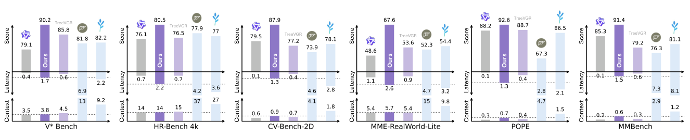

# Awesome Paper Figures

个人收藏：图画得好的论文，方便画图时找参考。

- 数据源：[`papers.yaml`](papers.yaml)，图片存放在 `figures/<paper-id>/`
- 修改后运行 `python3 scripts/build_readme.py` 重新生成本文件（请勿手动编辑 README）

共收录 **4** 篇论文，**7** 张图。

## 目录

- [按论文浏览](#按论文浏览)
- [Teaser / Figure 1](#teaser--figure-1) (2)
- [方法框架图 / Pipeline](#方法框架图--pipeline) (0)
- [概念示意图 / Motivation](#概念示意图--motivation) (2)
- [实验结果图](#实验结果图) (2)
- [可视化 / 定性结果](#可视化--定性结果) (1)
- [表格](#表格) (0)

## 按论文浏览

| 论文 | 作者 | 发表 | 链接 | 收录日期 |
|---|---|---|---|---|
| Rethinking Latent Visual Reasoning: Grounding Latent Reasoning in Visual Evidence | Xi Xiao, Tianchen Zhao, Youngeun Kim, et al. | Preprint 2026 | [Paper](https://arxiv.org/abs/2609.34563) | 2026-10-26 |
| Why 1 + 1 < 1 in Visual Token Pruning: Beyond Naïve Integration via Multi-Objective Balanced Covering | Yangfu Li, Hongjian Zhan, Tianyi Chen, Qi Liu, Yu-jie Xiong, Yue Lu | NeurIPS 2025 | [Paper](https://arxiv.org/abs/2505.10118) · [Code](https://github.com/YChenL/MoB) | 2026-10-26 |
| DeepScan: A Training-Free Framework for Visually Grounded Reasoning in Large Vision-Language Models | Yangfu Li, Hongjian Zhan, Jiawei Chen, Yuning Gong, Qi Liu, Yue Lu | CVPR 2026 | [Paper](https://arxiv.org/abs/2603.03857) | 2026-10-26 |
| Perceptual Flow Network for Visually Grounded Reasoning | Yangfu Li, Yuning Gong, Hongjian Zhan, Teng Li, Yuanhuiyi Lyu, et al. | ICML 2026 | [Paper](https://arxiv.org/abs/2605.02730) | 2026-10-26 |

## Teaser / Figure 1

### Rethinking Latent Visual Reasoning: Grounding Latent Reasoning in Visual Evidence — Figure 1

*Preprint 2026* · [Paper](https://arxiv.org/abs/2609.34563)

> 💡 三栏 (a) 真实案例 + 红框放大细节、(b) LVR / ReaLVR 两行流程对比、(c) 横向条形量化证据，一张图讲完动机、方法与结论；蓝 / 粉两色分别对应 what / where，配色与正文呼应。

### Why 1 + 1 < 1 in Visual Token Pruning: Beyond Naïve Integration via Multi-Objective Balanced Covering — Figure 1

*NeurIPS 2025* · [Paper](https://arxiv.org/abs/2505.10118) · [Code](https://github.com/YChenL/MoB)

> 💡 (a) 正负双向柱状图 + 浅色背景分区标注好坏，(b) 绿 / 蓝两组密度直方图区分强弱耦合，(c) 三个预算下的雷达图并在每个轴上标注紫色相对提升，层层递进地支撑“1+1<1”的论点。

## 方法框架图 / Pipeline

_暂无_

## 概念示意图 / Motivation

### DeepScan: A Training-Free Framework for Visually Grounded Reasoning in Large Vision-Language Models — Figure 1

*CVPR 2026* · [Paper](https://arxiv.org/abs/2603.03857)

> 💡 用同一张卡通海狸示例左右对比 coarse-to-fine 与 bottom-up 两条 pipeline，失败分支半透明淡化、✗ / ✓ 图标标出成败，手绘风插图比真实图片更干净易懂。

### Perceptual Flow Network for Visually Grounded Reasoning — Figure 2

*ICML 2026* · [Paper](https://arxiv.org/abs/2605.02730)

> 💡 把隐空间画成一张 3D 曲面，对比“被专家轨迹拉偏 (Biased)”与“在邻域内向最优输出靠拢 (Closer)”，金色 / 紫色轨迹 + 力的箭头把抽象优化目标变成直观的几何图景。

## 实验结果图

### DeepScan: A Training-Free Framework for Visually Grounded Reasoning in Large Vision-Language Models — Figure 2

*CVPR 2026* · [Paper](https://arxiv.org/abs/2603.03857)

> 💡 柱状图用深紫 / 浅紫 / 浅蓝区分 training-free / training-based / 通用模型，本方法加粗黑框突出，虚线箭头与灰色斜体注释说明“可扩展”和基座分组。

### Perceptual Flow Network for Visually Grounded Reasoning — Figure 6

*ICML 2026* · [Paper](https://arxiv.org/abs/2605.02730)

> 💡 共享横轴的上下镜像柱状图：上方是分数，下方是延迟和上下文长度，“下方面积越小代价越低”的读法一目了然；各方法用 logo 图标代替图例。

## 可视化 / 定性结果

### Rethinking Latent Visual Reasoning: Grounding Latent Reasoning in Visual Evidence — Figure 3

*Preprint 2026* · [Paper](https://arxiv.org/abs/2609.34563)

> 💡 两张注意力矩阵并排，用彩色括号标出 Visual / Question / Latent / Answer 分区，框线 + 箭头注释直接点出“弱读出 vs 强读出”，红蓝发散色标配合灰色因果掩码，信息密度高但不乱。

## 表格

_暂无_
