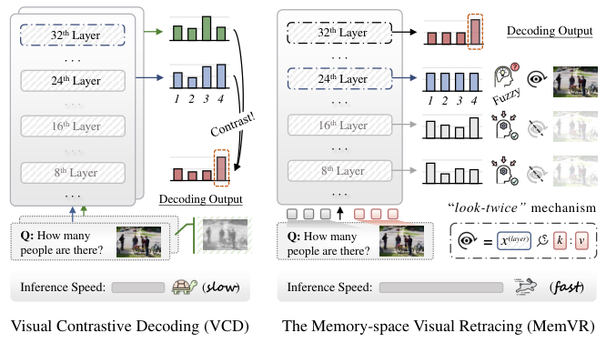
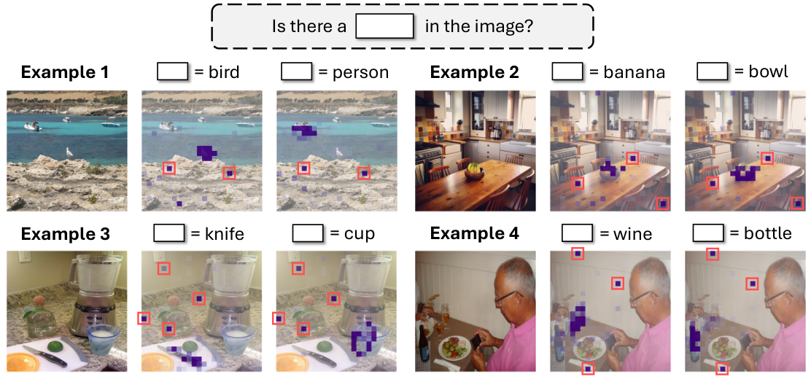

# Awesome Paper Figures

个人收藏：图画得好的论文，方便画图时找参考。

- 数据源：[`papers.yaml`](papers.yaml)，图片存放在 `figures/<paper-id>/`
- 修改后运行 `python3 scripts/build_readme.py` 重新生成 README、论文页和画廊页（依赖 `pyyaml`、`pillow`；请勿手动编辑生成的文件）

共收录 **7** 篇论文，**67** 张图。

## 按图类型浏览

[Teaser / 概念示意图](gallery/teaser.md) (9) · [方法框架图 / Pipeline](gallery/framework.md) (7) · [实验结果图](gallery/plot.md) (20) · [可视化 / 定性结果](gallery/visualization.md) (15) · [表格](gallery/table.md) (16)

## 按论文浏览

| 预览 | 论文 | 发表 | 图 | 链接 |
|---|---|---|---|---|
|  | [Rethinking Latent Visual Reasoning: Grounding Latent Reasoning in Visual Evidence](papers/realvr-2026.md) | Preprint 2026 | 3 | [Paper](https://arxiv.org/abs/2609.34563) |
|  | [Why 1 + 1 < 1 in Visual Token Pruning: Beyond Naïve Integration via Multi-Objective Balanced Covering](papers/mob-2025.md) | NeurIPS 2025 | 1 | [Paper](https://arxiv.org/abs/2505.10118) · [Code](https://github.com/YChenL/MoB) |
|  | [DeepScan: A Training-Free Framework for Visually Grounded Reasoning in Large Vision-Language Models](papers/deepscan-2026.md) | CVPR 2026 | 11 | [Paper](https://arxiv.org/abs/2603.03857) |
|  | [Perceptual Flow Network for Visually Grounded Reasoning](papers/pflownet-2026.md) | ICML 2026 | 11 | [Paper](https://arxiv.org/abs/2605.02730) |
|  | [Look Twice Before You Answer: Memory-Space Visual Retracing for Hallucination Mitigation in Multimodal Large Language Models](papers/memvr-2025.md) | ICML 2025 | 19 | [Paper](https://arxiv.org/abs/2410.03577) · [Code](https://github.com/1zhou-Wang/MemVR) |
|  | [Don't Just Chase "Highlighted Tokens" in MLLMs: Revisiting Visual Holistic Context Retention](papers/holov-2025.md) | NeurIPS 2025 | 16 | [Paper](https://arxiv.org/abs/2510.02912) · [Code](https://github.com/obananas/HoloV) |
|  | [See What You Are Told: Visual Attention Sink in Large Multimodal Models](papers/attnsink-2025.md) | ICLR 2025 | 6 | [Paper](https://arxiv.org/abs/2503.03321) |
