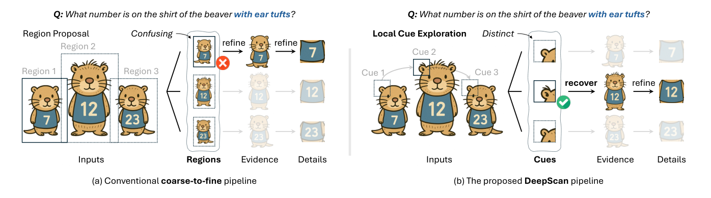
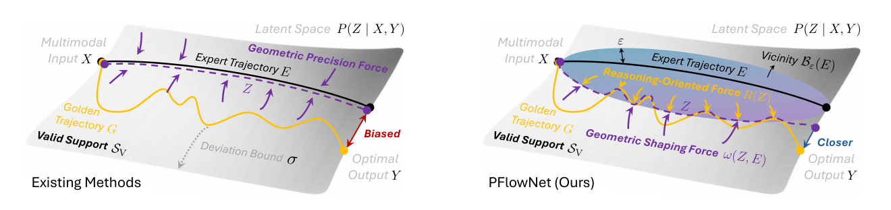
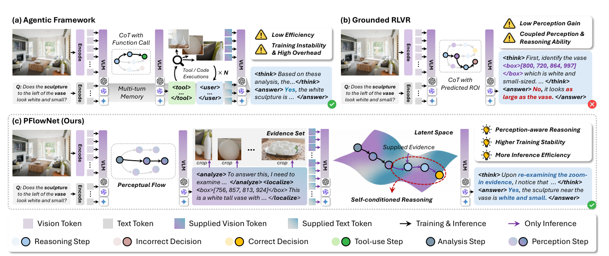
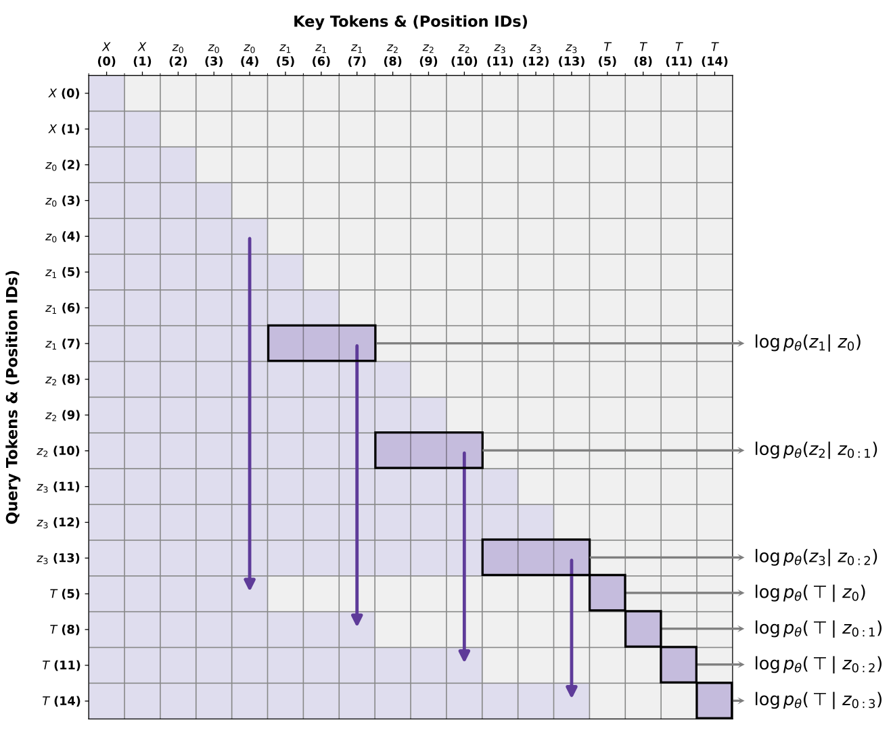
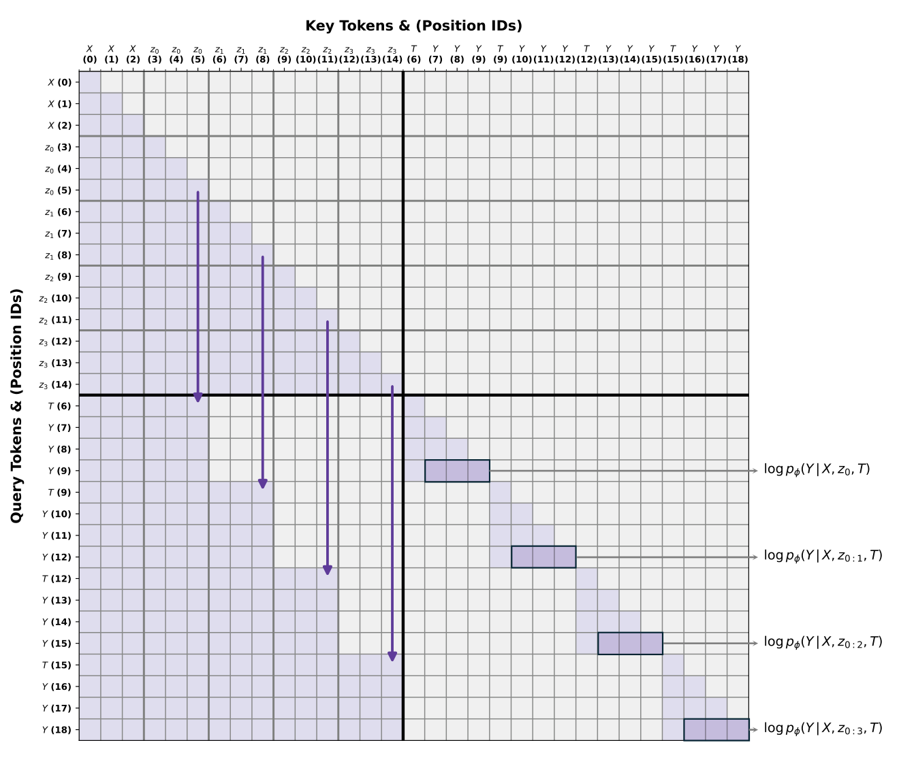

# 概念示意图 / Motivation

[← 返回目录](../README.md) · 共 5 张

|   |   |   |
|---|---|---|
|  **DeepScan** · Figure 1 |  **PFlowNet** · Figure 2 |  **PFlowNet** · Figure 11 |
|  **PFlowNet** · Figure 12 |  **PFlowNet** · Figure 13 |   |
