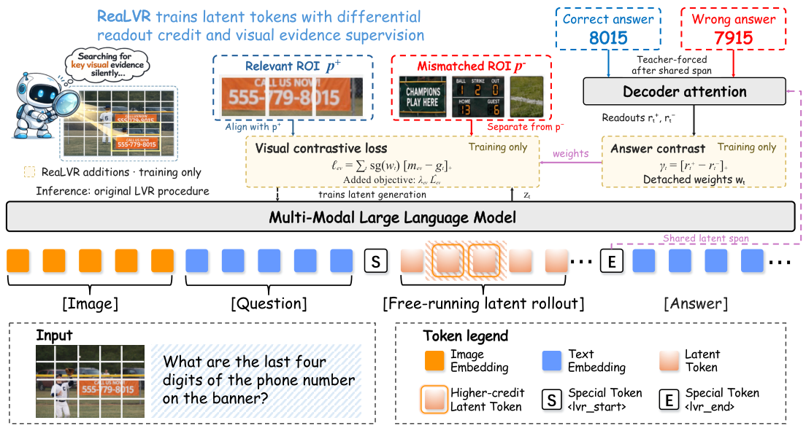
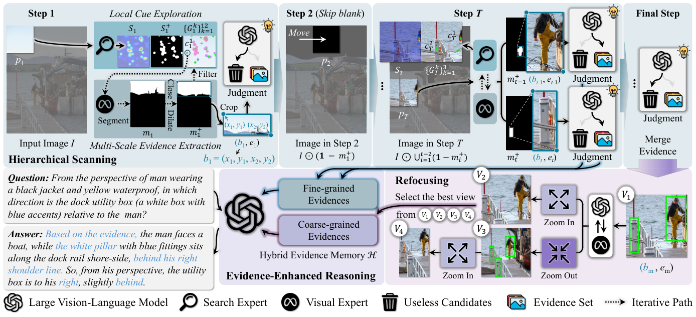
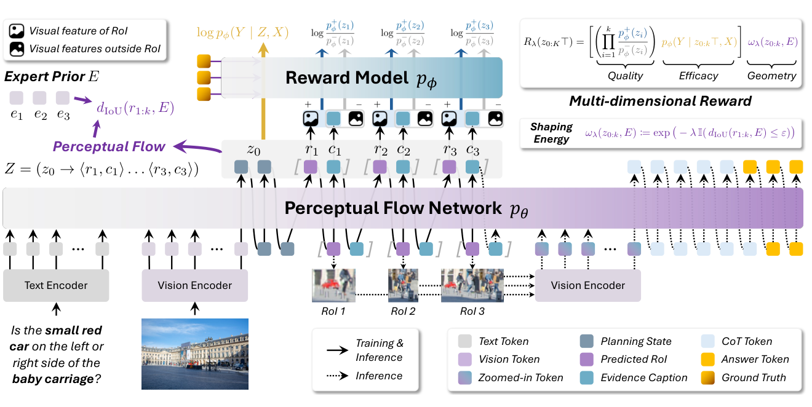
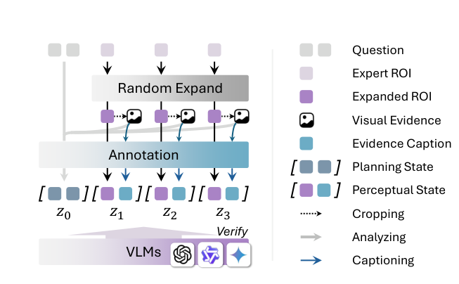
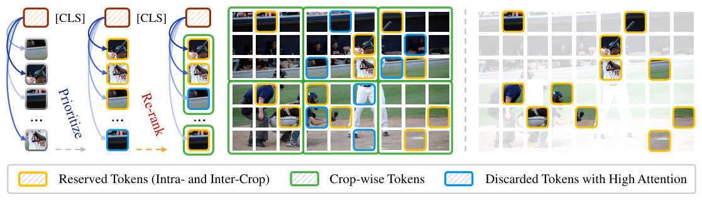
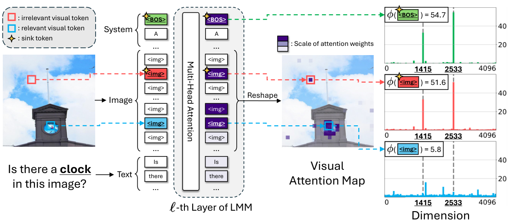
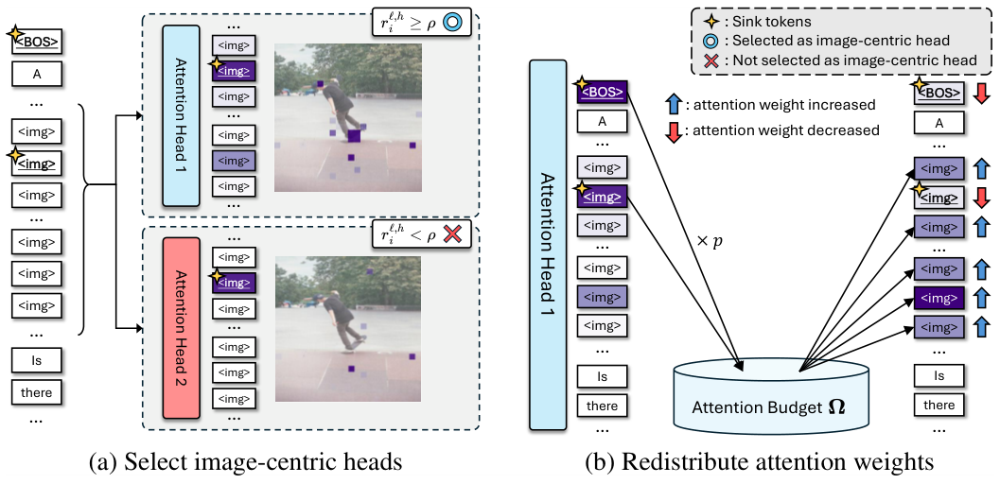
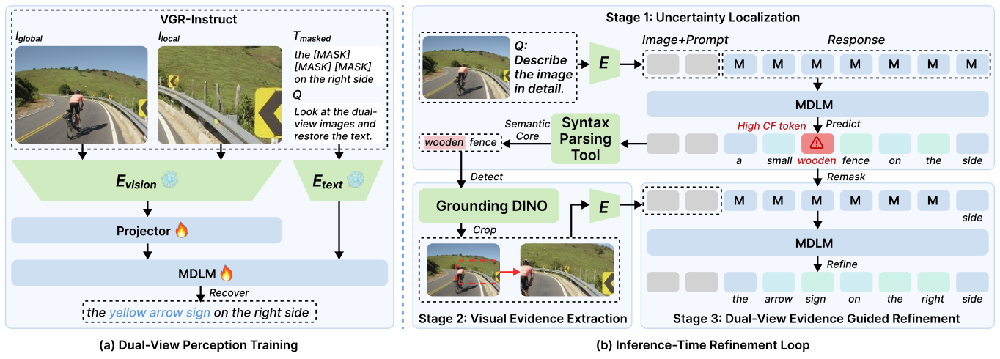

# 方法框架图 / Pipeline

[← 返回目录](../README.md) · 共 8 张

|   |   |   |
|---|---|---|
|  **ReaLVR** · Figure 2 |  **DeepScan** · Figure 3 |  **PFlowNet** · Figure 3 |
|  **PFlowNet** · Figure 4 |  **HoloV** · Figure 7 |  **VAR** · Figure 2 |
|  **VAR** · Figure 5 |  **VGR** · Figure 4 |   |
