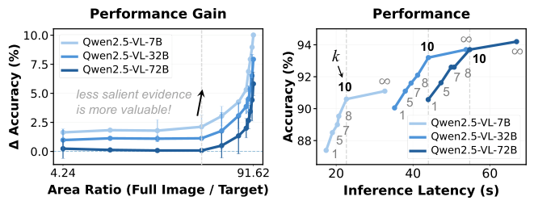
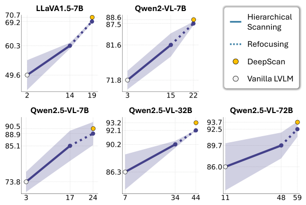
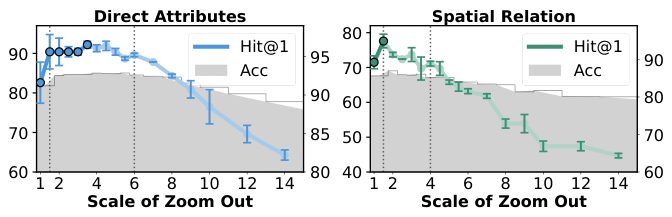
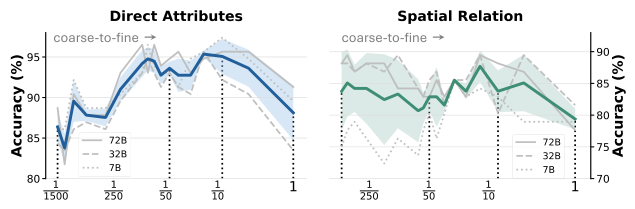
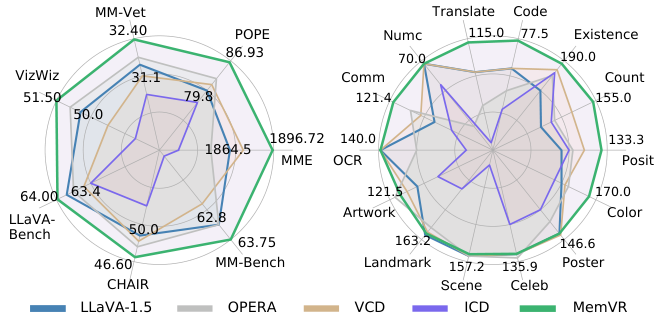
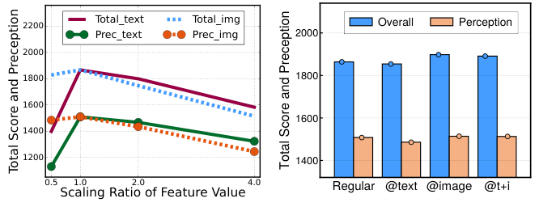
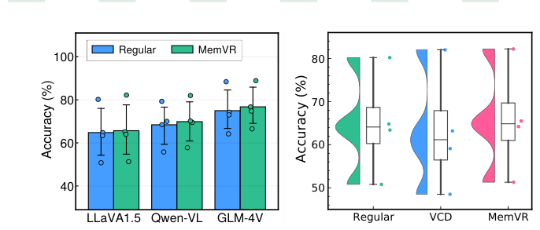
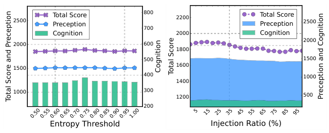
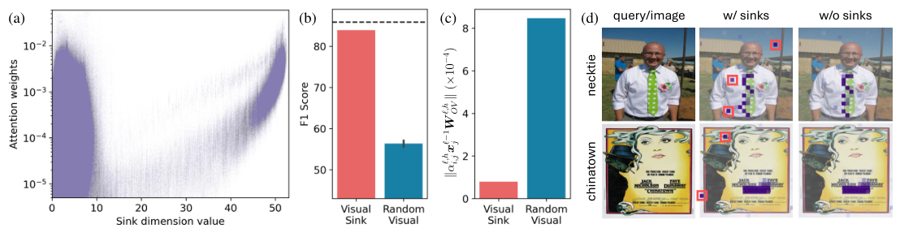

# 实验结果图

[← 返回目录](../README.md) · 共 22 张

|   |   |   |
|---|---|---|
|  **DeepScan** · Figure 2 |  **DeepScan** · Figure 5 |  **DeepScan** · Figure 7 |
|  **DeepScan** · Figure 8 |  **DeepScan** · Figure 11 |  **PFlowNet** · Figure 5 |
|  **PFlowNet** · Figure 6 |  **PFlowNet** · Figure 7 |  **PFlowNet** · Figure 9 |
|  **PFlowNet** · Figure 10 |  **MemVR** · Figure 2 |  **MemVR** · Figure 4 |
|  **MemVR** · Figure 6 |  **MemVR** · Figure 7 |  **HoloV** · Figure 2 |
|  **HoloV** · Figure 5 |  **HoloV** · Figure 6 |  **HoloV** · Figure 8 |
|  **HoloV** · Figure 9 |  **VAR** · Figure 3 |  **VGR** · Figure 2 |
|  **VGR** · Figure 3 |   |   |
