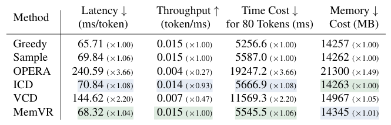
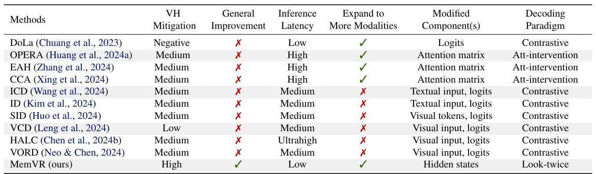
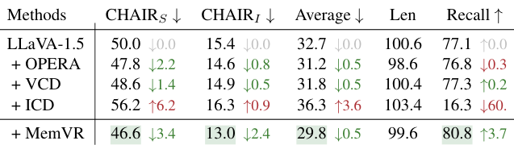
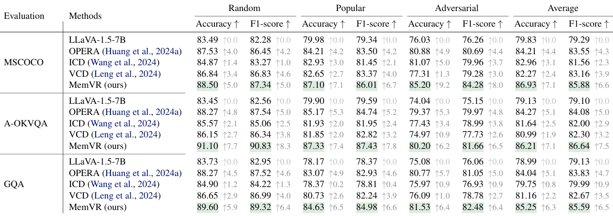
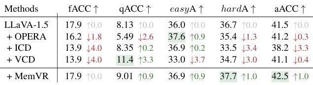
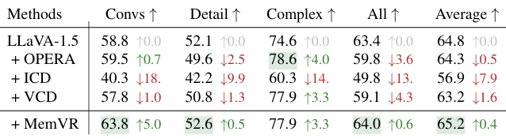
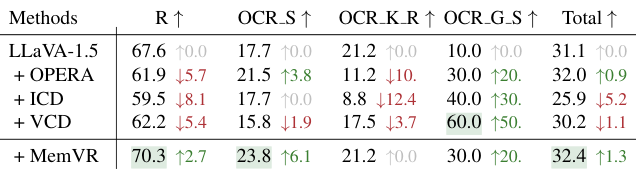
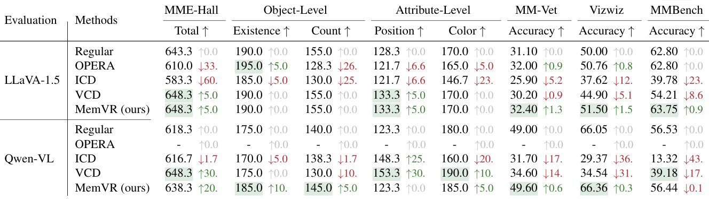
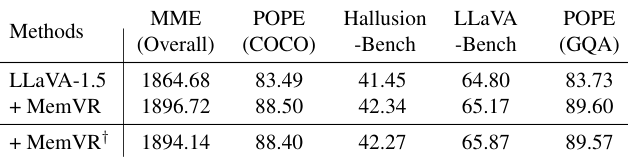
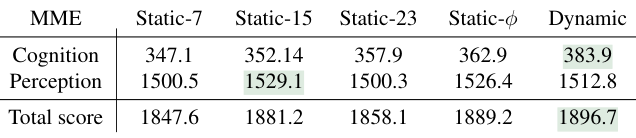

# 表格

[← 返回目录](../README.md) · 共 16 张

|   |   |   |
|---|---|---|
|  **MemVR** · Table 1 |  **MemVR** · Table 2 |  **MemVR** · Table 3 |
|  **MemVR** · Table 4 |  **MemVR** · Table 5 |  **MemVR** · Table 6 |
|  **MemVR** · Table 7 |  **MemVR** · Table 8 |  **MemVR** · Table 9 |
|  **MemVR** · Table 10 |  **HoloV** · Table 1 |  **HoloV** · Table 2 |
|  **HoloV** · Table 3 |  **HoloV** · Table 4 |  **HoloV** · Table 5 |
|  **HoloV** · Table 6 |   |   |
