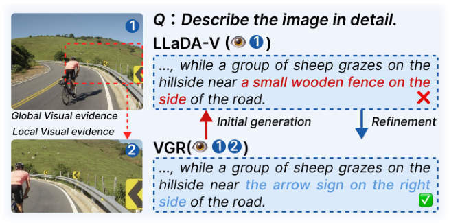

# Teaser / 概念示意图

[← 返回目录](../README.md) · 共 10 张

|   |   |   |
|---|---|---|
|  **ReaLVR** · Figure 1 |  **MoB** · Figure 1 |  **DeepScan** · Figure 1 |
|  **PFlowNet** · Figure 1 |  **PFlowNet** · Figure 2 |  **PFlowNet** · Figure 11 |
|  **MemVR** · Figure 1 |  **HoloV** · Figure 1 |  **VAR** · Figure 1 |
|  **VGR** · Figure 1 |   |   |
