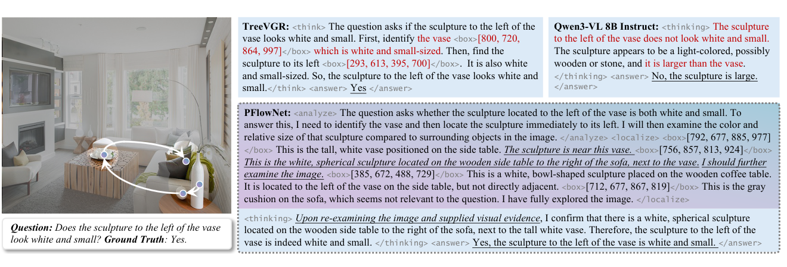
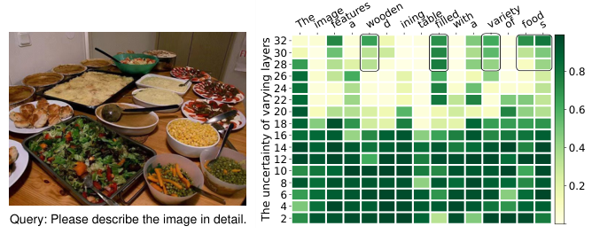
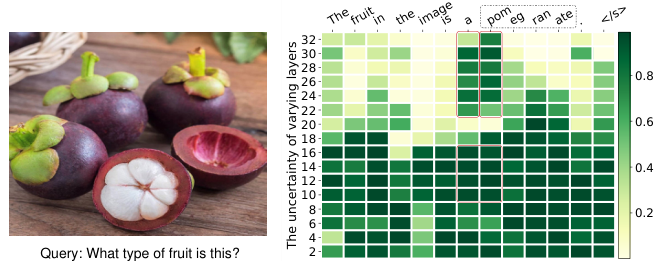
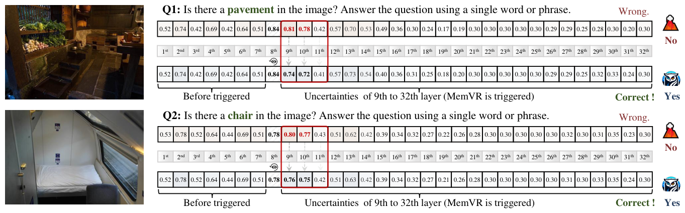
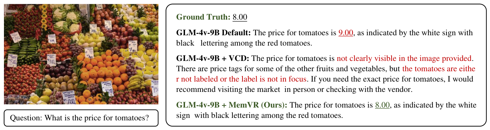

# 可视化 / 定性结果

[← 返回目录](../README.md) · 共 9 张

|   |   |   |
|---|---|---|
|  **ReaLVR** · Figure 3 |  **PFlowNet** · Figure 8 |  **MemVR** · Figure 3 |
|  **MemVR** · Figure 5 |  **MemVR** · Figure 8 |  **MemVR** · Figure 9 |
|  **HoloV** · Figure 3 |  **HoloV** · Figure 4 |  **HoloV** · Figure 10 |
