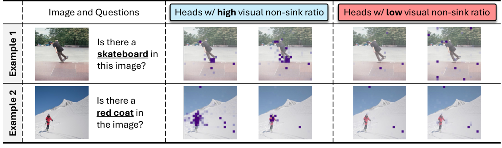
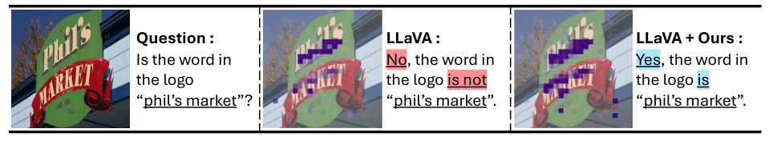

# See What You Are Told: Visual Attention Sink in Large Multimodal Models

[← 返回目录](../README.md)

- **作者**：Seil Kang, Jinyeong Kim, Junhyeok Kim, Seong Jae Hwang
- **发表**：ICLR 2025
- **链接**：[Paper](https://arxiv.org/abs/2503.03321)
- **收录日期**：2026-10-26

## TL;DR

- **动机**：LMM 总会把很高的注意力分给某些与文本无关的视觉 token；作者发现这些 token 源于隐藏状态中少数维度的巨大激活，类似语言模型中的 attention sink，称为“视觉注意力汇（visual attention sink）”，且去掉它们并不影响模型输出。
- **方法**：提出 Visual Attention Redistribution（VAR）：先找出天生关注图像的 image-centric heads，再把这些头里分给 sink token 的注意力“回收”为预算，按比例重新分配给其他视觉 token；无需训练、额外模型或额外推理步骤。
- **效果**：在通用视觉语言任务、视觉幻觉任务和以视觉为中心的任务上，多个 LMM 都获得一致提升。

## Figures

<b>Figure 1</b> · <a href="../gallery/teaser.md">Teaser / 概念示意图</a>  💡 用“Is there a □ in the image?”模板串起四组例子，紫色注意力块叠加在图像上，红框标出无关却高注意力的 sink token，一眼看出现象。

<b>Figure 2</b> · <a href="../gallery/framework.md">方法框架图 / Pipeline</a>  💡 左侧 LMM 结构示意（token 小方块 + 多头注意力），中间注意力图，右侧三张隐藏状态维度柱状图；红 / 蓝 / 星标分别对应无关、相关和 sink token，颜色贯穿全图。

<b>Figure 3</b> · <a href="../gallery/plot.md">实验结果图</a>  💡 (a) 散点密度图 + (b)(c) 简洁柱状对比 + (d) 有无 sink 的可视化，四个面板从统计到案例层层递进。

<b>Figure 4</b> · <a href="../gallery/visualization.md">可视化 / 定性结果</a>  💡 表格式排版的注意力可视化：两行例子 × 高 / 低 non-sink 比例的注意力头，表头用蓝 / 红底色区分两组。

<b>Figure 5</b> · <a href="../gallery/framework.md">方法框架图 / Pipeline</a>  💡 VAR 方法示意：(a) 用圆圈 / 叉号筛选 image-centric heads，(b) 把 sink 注意力汇入“Attention Budget”桶再分配，蓝 / 红箭头表示权重增减，比喻直观。

<b>Figure 6</b> · <a href="../gallery/visualization.md">可视化 / 定性结果</a>  💡 一行三联图：问题、LLaVA 回答、加 VAR 后回答，红 / 蓝高亮关键词，注意力块叠加在 logo 上。

