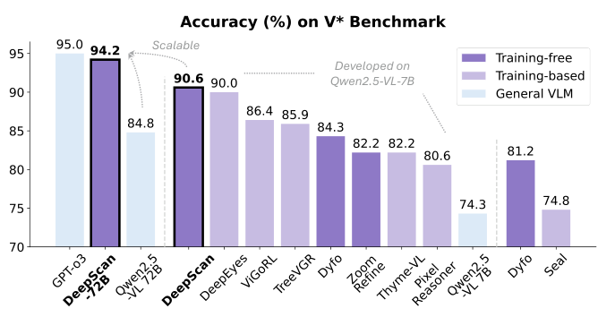

# DeepScan: A Training-Free Framework for Visually Grounded Reasoning in Large Vision-Language Models

[← 返回目录](../README.md)

- **作者**：Yangfu Li, Hongjian Zhan, Jiawei Chen, Yuning Gong, Qi Liu, Yue Lu
- **发表**：CVPR 2026
- **链接**：[Paper](https://arxiv.org/abs/2603.03857)
- **收录日期**：2026-10-26

## TL;DR

- **动机**：现有 visually grounded reasoning 方法大多是自上而下的 coarse-to-fine：先在整张图上一次性框出完整证据区域再细化，容易被嘈杂背景（attention sink）和外观相似的物体（attention drift）带偏。
- **方法**：提出免训练框架 DeepScan，模仿人“先找局部线索、再还原整体”的方式：Hierarchical Scanning 先在图像块上探索局部线索并多尺度提取证据，自下而上恢复目标；Refocusing 让 LVLM 与视觉专家协作调整证据视野；Evidence-Enhanced Reasoning 用混合证据记忆提供多粒度视图来作答。
- **效果**：Qwen2.5-VL-7B 在 V* 上达到 90.6%（+16.3%），无需训练即可迁移到不同架构，并扩展到 72B 模型。

## Figure 1

类型：[概念示意图 / Motivation](../gallery/concept.md)

> 💡 用同一张卡通海狸示例左右对比 coarse-to-fine 与 bottom-up 两条 pipeline，失败分支半透明淡化、✗ / ✓ 图标标出成败，手绘风插图比真实图片更干净易懂。

## Figure 2

类型：[实验结果图](../gallery/plot.md)

> 💡 柱状图用深紫 / 浅紫 / 浅蓝区分 training-free / training-based / 通用模型，本方法加粗黑框突出，虚线箭头与灰色斜体注释说明“可扩展”和基座分组。

