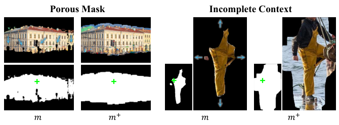
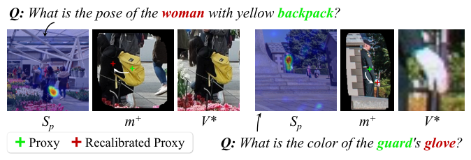
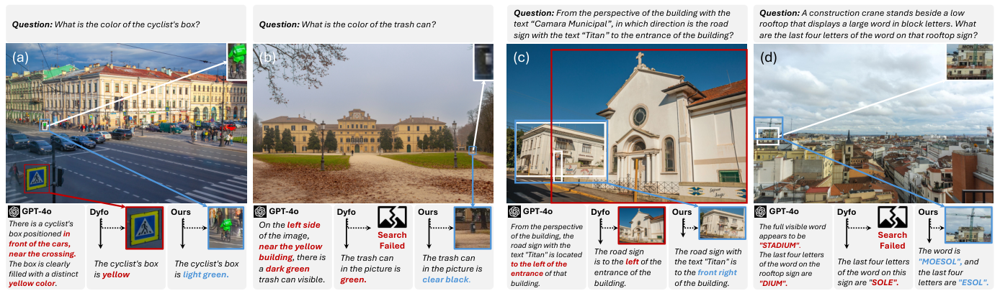
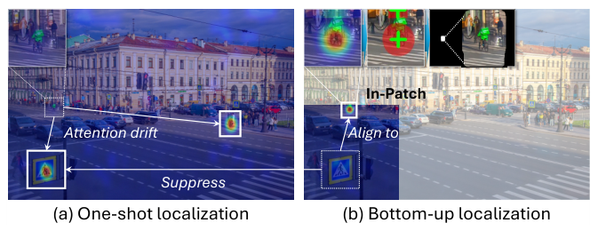

# DeepScan: A Training-Free Framework for Visually Grounded Reasoning in Large Vision-Language Models

[← 返回目录](../README.md)

- **作者**：Yangfu Li, Hongjian Zhan, Jiawei Chen, Yuning Gong, Qi Liu, Yue Lu
- **发表**：CVPR 2026
- **链接**：[Paper](https://arxiv.org/abs/2603.03857)
- **收录日期**：2026-10-26

## TL;DR

- **动机**：现有 visually grounded reasoning 方法大多是自上而下的 coarse-to-fine：先在整张图上一次性框出完整证据区域再细化，容易被嘈杂背景（attention sink）和外观相似的物体（attention drift）带偏。
- **方法**：提出免训练框架 DeepScan，模仿人“先找局部线索、再还原整体”的方式：Hierarchical Scanning 先在图像块上探索局部线索并多尺度提取证据，自下而上恢复目标；Refocusing 让 LVLM 与视觉专家协作调整证据视野；Evidence-Enhanced Reasoning 用混合证据记忆提供多粒度视图来作答。
- **效果**：Qwen2.5-VL-7B 在 V* 上达到 90.6%（+16.3%），无需训练即可迁移到不同架构，并扩展到 72B 模型。

## Figures

<b>Figure 1</b> · <a href="../gallery/teaser.md">Teaser / 概念示意图</a>  💡 用同一张卡通海狸示例左右对比 coarse-to-fine 与 bottom-up 两条 pipeline，失败分支半透明淡化、✗ / ✓ 图标标出成败，手绘风插图比真实图片更干净易懂。

<b>Figure 2</b> · <a href="../gallery/plot.md">实验结果图</a>  💡 柱状图用深紫 / 浅紫 / 浅蓝区分 training-free / training-based / 通用模型，本方法加粗黑框突出，虚线箭头与灰色斜体注释说明“可扩展”和基座分组。

<b>Figure 3</b> · <a href="../gallery/framework.md">方法框架图 / Pipeline</a>  💡 整体框架图：上排按 Step 1 → Step T → Final Step 展开 Hierarchical Scanning，下排左右分别是 Evidence-Enhanced Reasoning 和 Refocusing；浅蓝 / 浅紫背景分区，底部统一图标图例，信息量大但层次清楚。

<table><tr>
<td width="50%" valign="top"><b>Figure 4</b> · <a href="../gallery/visualization.md">可视化 / 定性结果</a>  💡 形态学后处理示意：Porous Mask 与 Incomplete Context 两组 m → m⁺ 对比，绿色十字标出种子点，黑白掩码与原图配对展示。</td>
<td width="50%" valign="top"><b>Figure 5</b> · <a href="../gallery/plot.md">实验结果图</a>  💡 左图性能增益随目标面积比变化（蓝色深浅表示模型规模），右图性能-延迟曲线并在点旁标 k 值，配色统一。</td>
</tr></table>

<table><tr>
<td width="50%" valign="top"><b>Figure 6</b> · <a href="../gallery/visualization.md">可视化 / 定性结果</a>  💡 Refocusing 示意：两个问题各配 Sₚ → m⁺ → V* 三联图，绿色 / 红色十字区分原始与校准后的代理点，问题中关键词彩色高亮。</td>
<td width="50%" valign="top"><b>Figure 7</b> · <a href="../gallery/plot.md">实验结果图</a>  💡 2×3 小多图展示各 LVLM 加上各模块后的提升，实线 / 虚线 / 金点 / 空心点分别表示不同阶段，浅紫置信带表示子集间方差，图例单独占一格。</td>
</tr></table>

<b>Figure 8</b> · <a href="../gallery/plot.md">实验结果图</a>  💡 双 y 轴：灰色面积表示准确率、彩色带误差棒折线表示 Hit@1，虚线标出最优缩放倍数。

<b>Figure 9</b> · <a href="../gallery/visualization.md">可视化 / 定性结果</a>  💡 四组案例横排：每组上方问题、中间原图 + 放大框连线、下方 GPT-4o / Dyfo / Ours 三栏回答，红色标错误、蓝色标正确，Search Failed 用图标表示。

<table><tr>
<td width="50%" valign="top"><b>Figure 10</b> · <a href="../gallery/visualization.md">可视化 / 定性结果</a>  💡 One-shot vs Bottom-up 定位对比：热力图叠加在原图上，白框 + 箭头标出注意力漂移与对齐过程。</td>
<td width="50%" valign="top"><b>Figure 11</b> · <a href="../gallery/plot.md">实验结果图</a>  💡 性能随 top-k 变化的曲线，三种模型规模用不同线型，置信带 + 竖虚线标注关键 k 值。</td>
</tr></table>

