# Don't Just Chase "Highlighted Tokens" in MLLMs: Revisiting Visual Holistic Context Retention

[← 返回目录](../README.md)

- **作者**：Xin Zou, Di Lu, Yizhou Wang, Yibo Yan, Yuanhuiyi Lyu, et al.
- **发表**：NeurIPS 2025
- **链接**：[Paper](https://arxiv.org/abs/2510.02912) · [Code](https://github.com/obananas/HoloV)
- **收录日期**：2026-10-26

## TL;DR

- **动机**：现有视觉 token 剪枝多是“注意力优先”（按文本-视觉交叉注意力或 [CLS] 注意力保留高亮 token），但这些 token 往往语义相似、扎堆在少数区域，高剪枝率下性能断崖式下降。
- **方法**：提出即插即用的 HoloV，从整体上下文角度重新考虑保留哪些 token：把图像划分为多个空间 crop，在 crop 之间自适应分配剪枝预算，并在 crop 内外重排高亮 token，使保留的 token 覆盖全局视觉上下文而不是只盯着显著区域。
- **效果**：LLaVA-1.5 剪掉 88.9% 视觉 token 后仍保留 95.8% 性能；在多种 MLLM（LLaVA-NeXT、Qwen2.5-VL、视频模型）和剪枝率下优于 SOTA。

## Figure 1

类型：[Teaser / 概念示意图](../gallery/teaser.md)

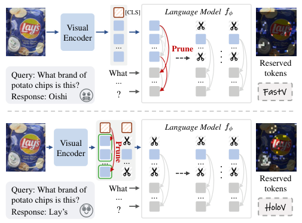

> 💡 上下两行对比 FastV 与 HoloV 的剪枝流程，右侧直接展示保留下来的 token 和回答结果（Oishi ✗ vs Lay's ✓），带表情图标，生动直观。

## Figure 2

类型：[实验结果图](../gallery/plot.md)

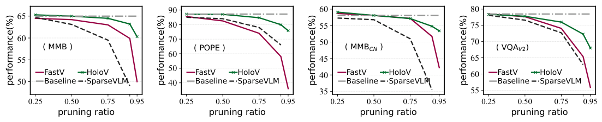

> 💡 四个小折线图展示性能随剪枝率变化，HoloV 绿线在高剪枝率下明显更稳，图例统一。

## Figure 3

类型：[可视化 / 定性结果](../gallery/visualization.md)

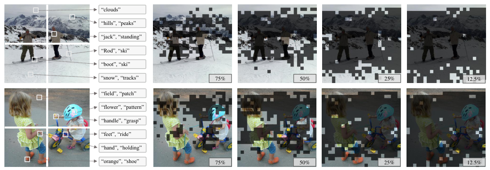

> 💡 左侧把图像块连线到对应语义词，右侧按 75% → 12.5% 逐步展示保留的 token，暗化被剪掉的区域，渐进式排版很直观。

## Figure 4

类型：[可视化 / 定性结果](../gallery/visualization.md)

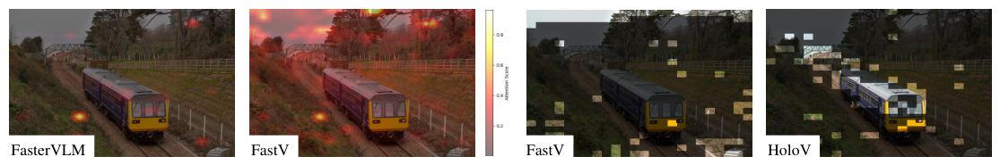

> 💡 注意力热力图与保留 token 可视化并排，FastV 扎堆、HoloV 分散的对比一目了然。

## Figure 5

类型：[实验结果图](../gallery/plot.md)

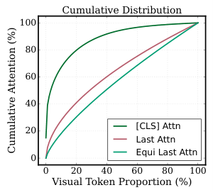

> 💡 累积分布曲线小图，说明 [CLS] 注意力高度集中，嵌在正文旁节省版面。

## Figure 6

类型：[实验结果图](../gallery/plot.md)

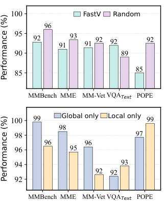

> 💡 上下两个柱状图分别对比 FastV vs 随机、Global vs Local，柱顶标数值，浅色配色柔和。

## Figure 7

类型：[方法框架图 / Pipeline](../gallery/framework.md)

> 💡 方法示意：左侧 Prioritize → Re-rank 两步，右侧网格展示按 crop 保留 token，黄 / 绿 / 蓝三种边框区分保留、crop 内、高注意力被丢弃的 token，底部图例清晰。

## Figure 8

类型：[实验结果图](../gallery/plot.md)

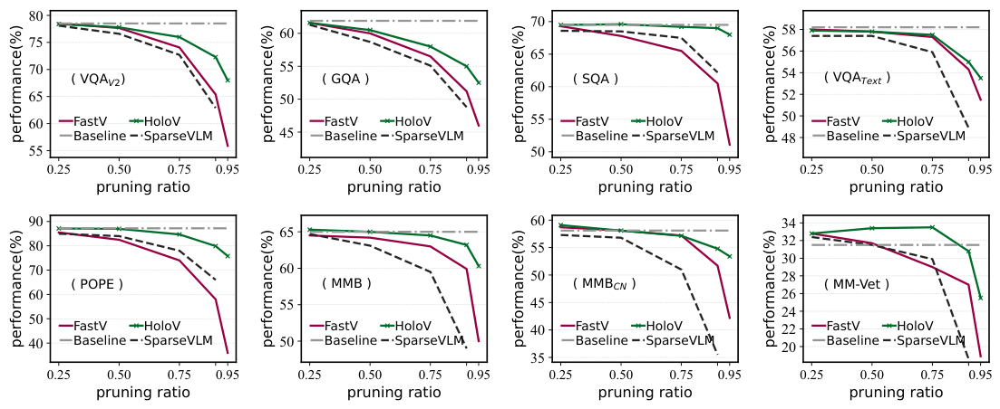

> 💡 2×4 小多图网格，统一坐标和图例，适合作为“多基准 × 多剪枝率”结果展示的模板。

## Figure 9

类型：[实验结果图](../gallery/plot.md)

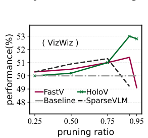

> 💡 单基准补充曲线，与 Fig 8 风格一致。

## Figure 10

类型：[可视化 / 定性结果](../gallery/visualization.md)

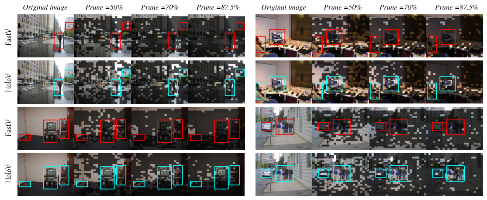

> 💡 4 行 × 多剪枝率的案例矩阵，FastV 用红框、HoloV 用青框标出关键目标，左侧竖排方法名，规整易比较。

## Table 1

类型：[表格](../gallery/table.md)

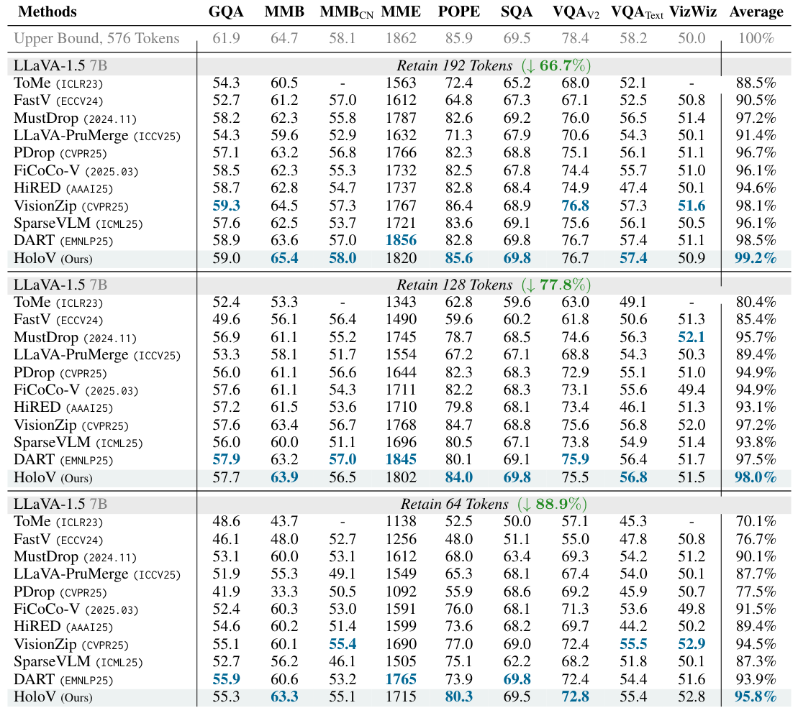

> 💡 大型主结果表：灰色 Upper Bound 行 + 灰底分组标题（Retain N Tokens，绿色标剪枝率），最优值蓝色加粗，本方法行浅底色。

## Table 2

类型：[表格](../gallery/table.md)

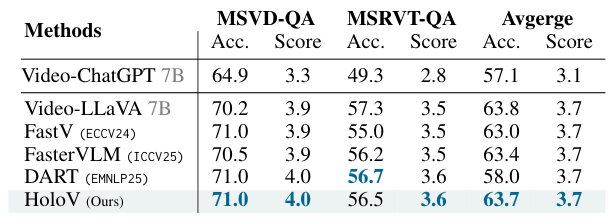

> 💡 视频 QA 小表，延续主表的分组和高亮风格。

## Table 3

类型：[表格](../gallery/table.md)

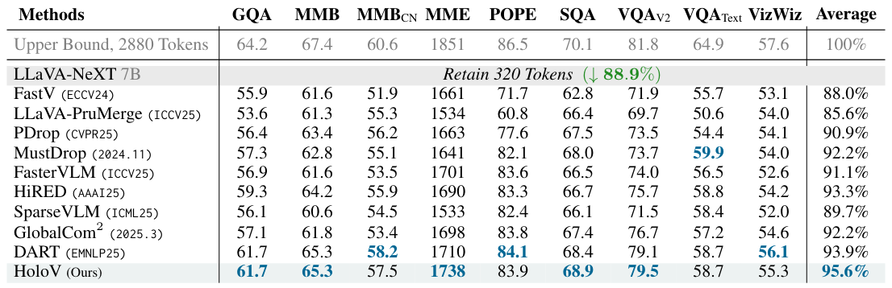

> 💡 LLaVA-NeXT 结果表，与 Table 1 同一模板。

## Table 4

类型：[表格](../gallery/table.md)

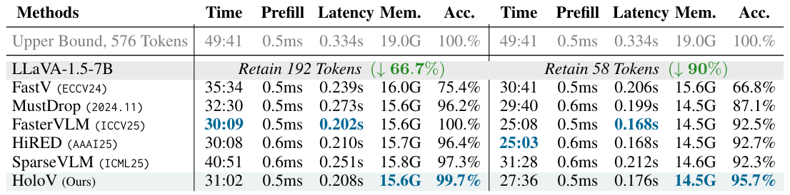

> 💡 效率表左右两组对称排列（66.7% / 90% 剪枝率），时间、显存、精度同表对比。

## Table 5

类型：[表格](../gallery/table.md)

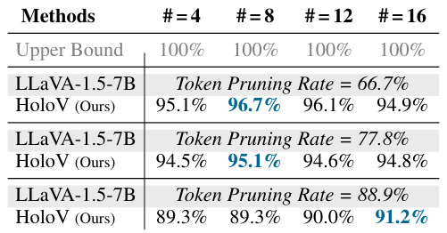

> 💡 crop 数量消融小表，按剪枝率分组，最优值蓝色加粗。

## Table 6

类型：[表格](../gallery/table.md)

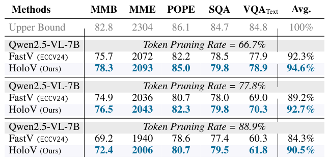

> 💡 Qwen2.5-VL 结果表，分组样式与主表一致。

