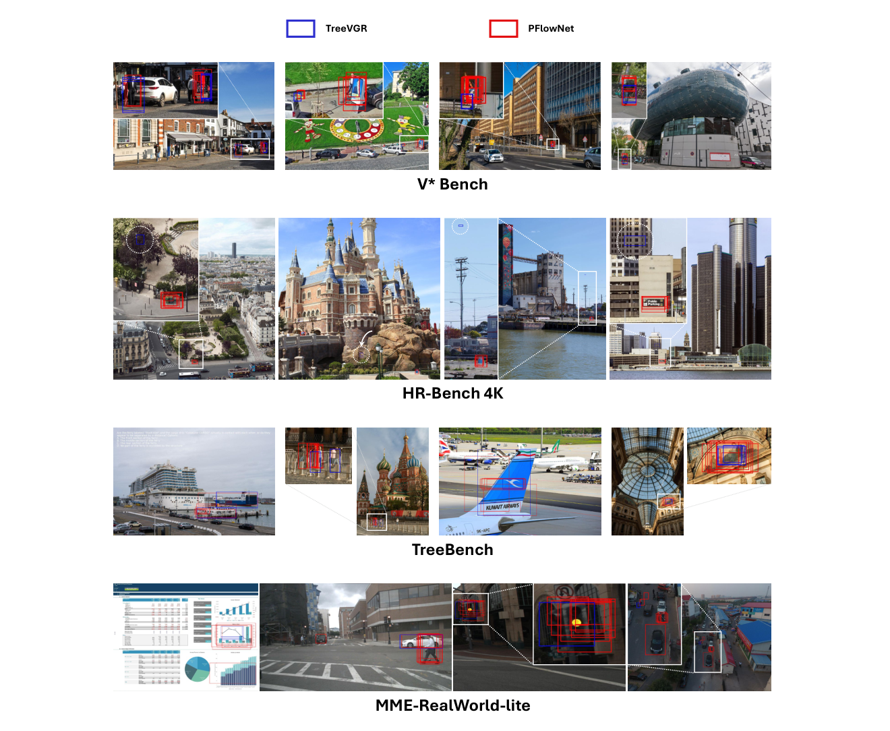
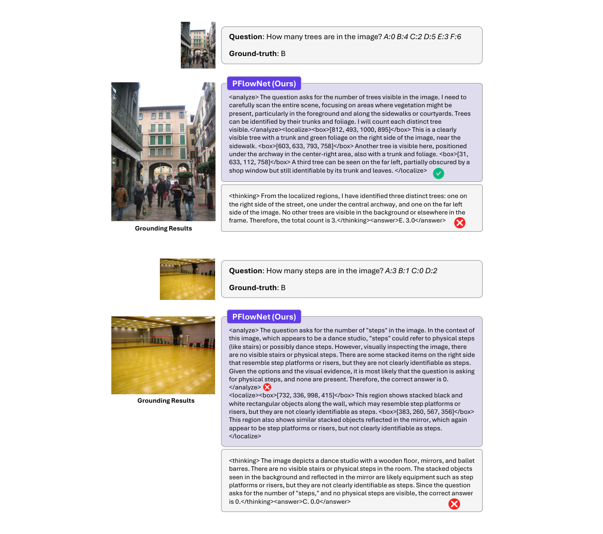
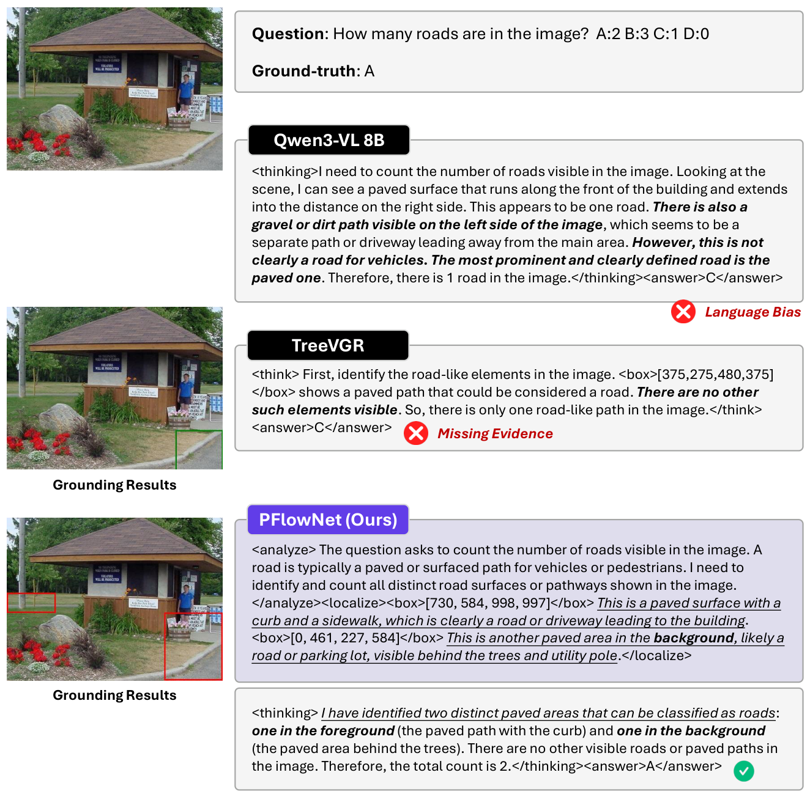
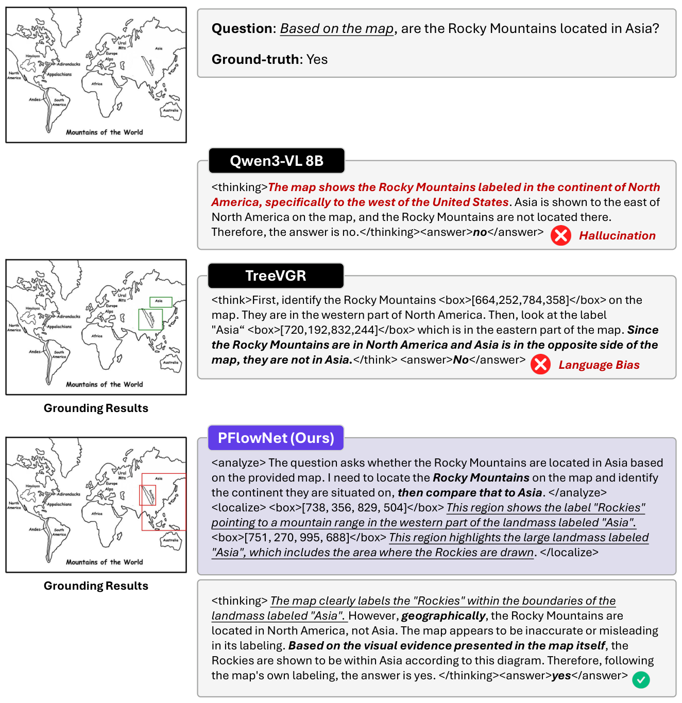

# Perceptual Flow Network for Visually Grounded Reasoning

[← 返回目录](../README.md)

- **作者**：Yangfu Li, Yuning Gong, Hongjian Zhan, Teng Li, Yuanhuiyi Lyu, et al.
- **发表**：ICML 2026
- **链接**：[Paper](https://arxiv.org/abs/2605.02730)
- **收录日期**：2026-10-26

## Figure 1

类型：[Teaser / Figure 1](../gallery/teaser.md)

> 💡 左侧用“原图 → 黄金证据 → 扩展 → 专家标注”的递进裁剪示意精度并非越高越好，右侧两条折线配置信带给出量化证据；绿 ✓ / 红 ✗ 角标与金色 Golden Priors 高亮串联图文。

## Figure 2

类型：[概念示意图 / Motivation](../gallery/concept.md)

> 💡 把隐空间画成一张 3D 曲面，对比“被专家轨迹拉偏 (Biased)”与“在邻域内向最优输出靠拢 (Closer)”，金色 / 紫色轨迹 + 力的箭头把抽象优化目标变成直观的几何图景。

## Figure 3

类型：[方法框架图 / Pipeline](../gallery/framework.md)

> 💡 整体框架图：底部编码器 → 中部 Perceptual Flow Network 长条渐变 → 顶部 Reward Model，右上角用花括号拆解多维奖励公式；token 用小色块编码并配完整图例，实线 / 虚线区分训练与推理。

## Figure 4

类型：[方法框架图 / Pipeline](../gallery/framework.md)

> 💡 数据合成流水线：Random Expand → Annotation → VLMs Verify 三层渐变条带堆叠，右侧竖排图例与左侧流程一一对应，紫 / 蓝色块延续全文的 token 配色。

## Figure 5

类型：[实验结果图](../gallery/plot.md)

> 💡 环形图 + 堆叠柱状图 + 双 y 轴折线的组合，同一组紫色深浅表示 RoI 数量，柱顶标数值，信息完整且配色统一。

## Figure 6

类型：[实验结果图](../gallery/plot.md)

> 💡 共享横轴的上下镜像柱状图：上方是分数，下方是延迟和上下文长度，“下方面积越小代价越低”的读法一目了然；各方法用 logo 图标代替图例。

## Figure 7

类型：[实验结果图](../gallery/plot.md)

> 💡 四个小多图并排的 Pass@k 曲线，统一图例放在底部，灰 / 浅紫 / 深紫三色对比清晰，简洁克制。

## Figure 8

类型：[可视化 / 定性结果](../gallery/visualization.md)

> 💡 定性对比：左侧原图上用白色弧形箭头画出感知路径，右侧三个浅色文本框分别展示各方法推理过程，红字标错、下划线标关键句，PFlowNet 用虚线框 + 渐变底色突出。

## Figure 9

类型：[实验结果图](../gallery/plot.md)

> 💡 在 Fig 5 的样式基础上加入 after RFT 黑框柱和红色虚线箭头标注下降百分比，直观展示 RFT 前后输出长度的变化。

## Figure 10

类型：[实验结果图](../gallery/plot.md)

> 💡 2×4 训练曲线网格：上排对比不同正则方案，下排扫描 ε 与 λ，分别用紫色与蓝色渐变表示超参从小到大，色彩即图例。

## Figure 11

类型：[概念示意图 / Motivation](../gallery/concept.md)

> 💡 三种范式对比：(a) Agentic、(b) Grounded RLVR、(c) PFlowNet，每行都是“输入 → VLM → 推理过程 → 结论”，右侧用 ⚠️ / 💡 卡片总结优缺点，底部统一图例，排版整齐。

## Figure 12

类型：[概念示意图 / Motivation](../gallery/concept.md)

> 💡 用带位置 ID 的注意力掩码网格解释并行计算：浅紫阴影为可见区域，黑框标出各项概率对应的 token 块，右侧箭头连到公式，把实现细节画得一目了然。

## Figure 13

类型：[概念示意图 / Motivation](../gallery/concept.md)

> 💡 与 Fig 12 同一视觉语言，用粗黑线把矩阵分成四个区块，展示效率奖励的并行计算，适合作为“讲清楚 attention mask”类插图的参考。

## Figure 14

类型：[可视化 / 定性结果](../gallery/visualization.md)

> 💡 按 benchmark 分组的大图拼贴，蓝框 / 红框分别表示 TreeVGR 与 PFlowNet 的 grounding 结果，并用白色虚线放大局部，直观呈现预测多样性的差异。

## Figure 15

类型：[可视化 / 定性结果](../gallery/visualization.md)

> 💡 失败案例分析：左图右文，Question 卡片 + 紫色 PFlowNet 标签卡片 + 思考过程卡片竖排，✓ / ✗ 图标精确标在出错的步骤上。

## Figure 16

类型：[可视化 / 定性结果](../gallery/visualization.md)

> 💡 三方法纵向对比的案例卡片：黑底标签标出 baseline、紫底标签标出本方法，红色斜体标注错误类型（Language Bias / Missing Evidence），左侧配对应的 grounding 结果图。

## Figure 17

类型：[可视化 / 定性结果](../gallery/visualization.md)

> 💡 与 Fig 16 同一模板的地图案例，红色错误类型标签（Hallucination / Language Bias）与下划线关键推理句组合，可作为定性案例图的排版模板。

