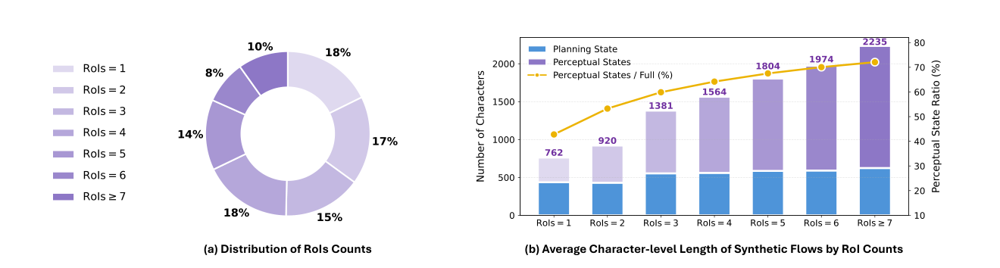
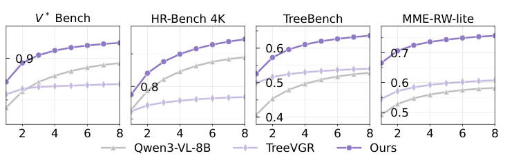
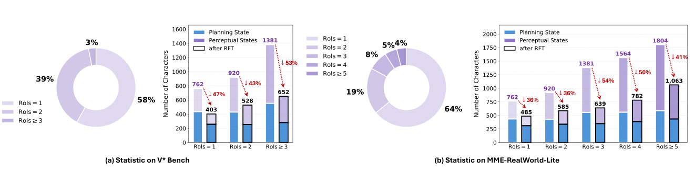
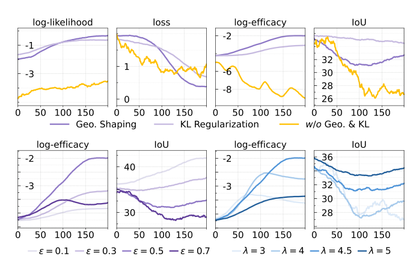

# Perceptual Flow Network for Visually Grounded Reasoning

[← 返回目录](../README.md)

- **作者**：Yangfu Li, Yuning Gong, Hongjian Zhan, Teng Li, Yuanhuiyi Lyu, et al.
- **发表**：ICML 2026
- **链接**：[Paper](https://arxiv.org/abs/2605.02730)
- **收录日期**：2026-10-26

## TL;DR

- **动机**：现有方法用视觉专家（如 GroundingDINO）的几何先验作为强化学习奖励来约束推理轨迹，但预实验发现：专家标注偏向几何精度，对推理并非最优——框得最准的证据不一定最有助于答对题。
- **方法**：提出 PFlowNet，把感知与推理解耦：模型先生成结构化的 perceptual flow（规划状态 + 一串 RoI 及其描述），再以此为条件作答；用变分强化学习结合多维奖励（质量 / 效能 / 几何）与邻域几何塑形，在专家先验附近探索更有利于推理的感知行为，并给出理论性能保证。
- **效果**：基于 Qwen3-VL-8B，在 V* Bench（90.6%）和 MME-RealWorld-lite（67.0%）上刷新 SOTA，推理延迟和上下文长度也低于 agentic 方法。

## Figures

<b>Figure 1</b> · <a href="../gallery/teaser.md">Teaser / 概念示意图</a>  💡 左侧用“原图 → 黄金证据 → 扩展 → 专家标注”的递进裁剪示意精度并非越高越好，右侧两条折线配置信带给出量化证据；绿 ✓ / 红 ✗ 角标与金色 Golden Priors 高亮串联图文。

<b>Figure 2</b> · <a href="../gallery/teaser.md">Teaser / 概念示意图</a>  💡 把隐空间画成一张 3D 曲面，对比“被专家轨迹拉偏 (Biased)”与“在邻域内向最优输出靠拢 (Closer)”，金色 / 紫色轨迹 + 力的箭头把抽象优化目标变成直观的几何图景。

<b>Figure 3</b> · <a href="../gallery/framework.md">方法框架图 / Pipeline</a>  💡 整体框架图：底部编码器 → 中部 Perceptual Flow Network 长条渐变 → 顶部 Reward Model，右上角用花括号拆解多维奖励公式；token 用小色块编码并配完整图例，实线 / 虚线区分训练与推理。

<b>Figure 4</b> · <a href="../gallery/framework.md">方法框架图 / Pipeline</a>  💡 数据合成流水线：Random Expand → Annotation → VLMs Verify 三层渐变条带堆叠，右侧竖排图例与左侧流程一一对应，紫 / 蓝色块延续全文的 token 配色。

<b>Figure 5</b> · <a href="../gallery/plot.md">实验结果图</a>  💡 环形图 + 堆叠柱状图 + 双 y 轴折线的组合，同一组紫色深浅表示 RoI 数量，柱顶标数值，信息完整且配色统一。

<b>Figure 6</b> · <a href="../gallery/plot.md">实验结果图</a>  💡 共享横轴的上下镜像柱状图：上方是分数，下方是延迟和上下文长度，“下方面积越小代价越低”的读法一目了然；各方法用 logo 图标代替图例。

<b>Figure 7</b> · <a href="../gallery/plot.md">实验结果图</a>  💡 四个小多图并排的 Pass@k 曲线，统一图例放在底部，灰 / 浅紫 / 深紫三色对比清晰，简洁克制。

<b>Figure 8</b> · <a href="../gallery/visualization.md">可视化 / 定性结果</a>  💡 定性对比：左侧原图上用白色弧形箭头画出感知路径，右侧三个浅色文本框分别展示各方法推理过程，红字标错、下划线标关键句，PFlowNet 用虚线框 + 渐变底色突出。

<b>Figure 9</b> · <a href="../gallery/plot.md">实验结果图</a>  💡 在 Fig 5 的样式基础上加入 after RFT 黑框柱和红色虚线箭头标注下降百分比，直观展示 RFT 前后输出长度的变化。

<b>Figure 10</b> · <a href="../gallery/plot.md">实验结果图</a>  💡 2×4 训练曲线网格：上排对比不同正则方案，下排扫描 ε 与 λ，分别用紫色与蓝色渐变表示超参从小到大，色彩即图例。

<b>Figure 11</b> · <a href="../gallery/teaser.md">Teaser / 概念示意图</a>  💡 三种范式对比：(a) Agentic、(b) Grounded RLVR、(c) PFlowNet，每行都是“输入 → VLM → 推理过程 → 结论”，右侧用 ⚠️ / 💡 卡片总结优缺点，底部统一图例，排版整齐。

