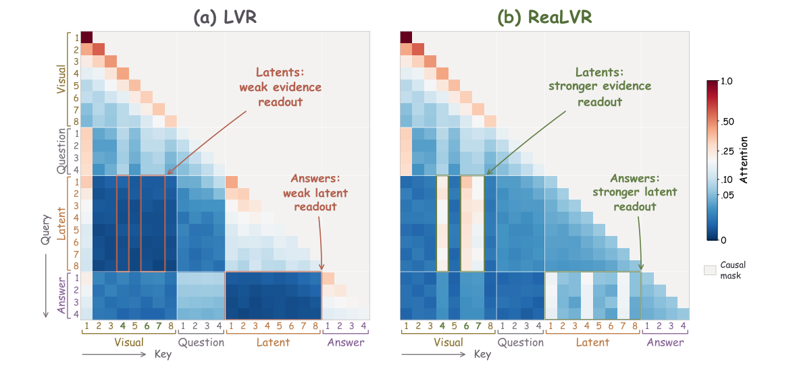

# Rethinking Latent Visual Reasoning: Grounding Latent Reasoning in Visual Evidence

[← 返回目录](../README.md)

- **作者**：Xi Xiao, Tianchen Zhao, Youngeun Kim, et al.
- **发表**：Preprint 2026
- **链接**：[Paper](https://arxiv.org/abs/2609.34563)
- **收录日期**：2026-10-26

## TL;DR

- **动机**：隐式视觉推理（LVR）中的 latent token 对“会改变正确答案的图像扰动”几乎不敏感（latent evidence-credit gap）：GRPO 只奖励最终答案，没有告诉 latent token 该保留什么视觉证据、哪些位置需要更强监督。
- **方法**：提出 ReaLVR，直接在模型自己生成的 latent 轨迹上加视觉证据监督：对比正确答案与模型采样出的错误答案对各 latent token 的注意力，决定“在哪里”加强监督；对比相关与不匹配的视觉证据，决定“保留什么”。只在训练时使用，不改模型结构和推理流程。
- **效果**：Qwen2.5-VL-7B 上五项任务平均 63.7%，优于已有 LVR 方法；首次把隐式视觉推理训练扩展到 235B 规模。

## Figures

<b>Figure 1</b> · <a href="../gallery/teaser.md">Teaser / 概念示意图</a>  💡 三栏 (a) 真实案例 + 红框放大细节、(b) LVR / ReaLVR 两行流程对比、(c) 横向条形量化证据，一张图讲完动机、方法与结论；蓝 / 粉两色分别对应 what / where，配色与正文呼应。

<b>Figure 3</b> · <a href="../gallery/visualization.md">可视化 / 定性结果</a>  💡 两张注意力矩阵并排，用彩色括号标出 Visual / Question / Latent / Answer 分区，框线 + 箭头注释直接点出“弱读出 vs 强读出”，红蓝发散色标配合灰色因果掩码，信息密度高但不乱。

