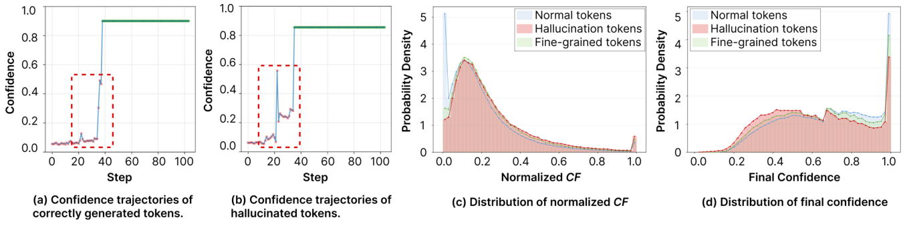
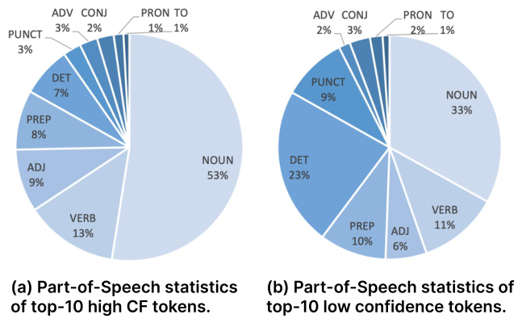

# When Diffusion Language Models Hesitate: Detecting and Correcting Visual Hallucinations via Confidence Fluctuation

[← 返回目录](../README.md)

- **作者**：Wenzheng Song, Pei Chen, Yichen Tan, Zejian Li, Lingyun Sun
- **发表**：ICML 2026
- **链接**：[Paper](https://openreview.net/forum?id=1knvdLwxQq) · [Code](https://github.com/SongWZ3214/VGR)
- **收录日期**：2026-10-26

## TL;DR

- **动机**：多模态扩散语言模型（MDLM）不像自回归模型那样逐步与视觉内容交互，只依赖初始化时编码好的静态视觉特征，去噪过程容易滑向语言先验、产生视觉幻觉；同时作者发现幻觉 token 在去噪过程中的置信度会明显“犹豫”（反复波动），而正确 token 平稳上升。
- **方法**：提出 VGR（Visual-Guided Refinement）：用去噪轨迹上的置信度波动（CF）定位不确定片段，经句法分析锚定到语义核心词；再用 Grounding DINO 找到并裁剪对应图像区域，对该片段原位重新 mask，并在全局图 + 局部裁剪的双视角条件下重新生成；训练阶段构建 VGR-Instruct 数据集做双视角感知微调。
- **效果**：在图像描述和幻觉评测基准上减少幻觉，同时召回更多细节。

## Figures

<b>Figure 1</b> · <a href="../gallery/teaser.md">Teaser / 概念示意图</a>  💡 上下两段文本框对比 LLaDA-V 与 VGR 的描述，红字 + ✗ 标幻觉、蓝字 + ✓ 标修正结果；左侧全局图到局部裁剪用红色虚线框和编号连接，红 / 蓝箭头表示“初始生成 → 修正”。

<b>Figure 2</b> · <a href="../gallery/plot.md">实验结果图</a>  💡 (a)(b) 置信度轨迹用红色虚线框圈出波动段，对比正常 token 与幻觉 token；(c)(d) 半透明叠加的密度直方图对比三类 token 的分布，从案例到统计一气呵成。

<b>Figure 3</b> · <a href="../gallery/plot.md">实验结果图</a>  💡 两个蓝色系饼图对比高 CF token 与低置信度 token 的词性分布，单色渐变 + 外部引线标注小扇区，干净克制。

<b>Figure 4</b> · <a href="../gallery/framework.md">方法框架图 / Pipeline</a>  💡 左右分为训练（双视角感知训练）与推理（三阶段修正循环），浅蓝底分区 + 绿色模块块，🔥 / ❄️ 标出可训练与冻结模块，M 方块直观表示 mask token，三个 Stage 用标题框串成闭环。

